# 📜 Technical Specification & Architecture: Real Owner Auto-Notifications & Multi-Tenant Publishing Targets

**Document Version:** 1.0.0  
**Status:** Approved Architectural Blueprint  
**System Scope:** Jupsoft Centralized Multi-Site Blog Platform (`backend` + `admin-portal` + `AWS SES`)  
**Target Entities:** Website Real Owners, Website Admins, Content Writers, Editors  

---

## 1. Executive Summary & Objective

This specification details the end-to-end architecture for two high-priority enterprise CMS governance capabilities:

1. **Real-Time Website Owner Notification on Blog Publication:**  
   Automatically dispatch a branded, executive-grade notification email via AWS SES to the real owner / client stakeholder (e.g. `management@jupsoft.com`, `director@gitarattan.com`) whenever a blog article transitions to `Published` status on their website, providing direct live links, featured images, and author attribution.

2. **Tenant-Wise Publishing Target (Aim / Quota) & Cadence Monitoring Engine:**  
   Empower administrators to configure granular monthly/weekly publishing targets per website (e.g. 15 blogs for Jupsoft, 20 blogs for DigifyNext, 10 blogs for Pdpschool). Continuously monitor pacing and automatically dispatch dual-channel reminders (**AWS SES Emails** and **In-App Portal Alerts**) to assigned **Content Writers** and **Website Admins** when a website falls behind its goal.

---

## 2. End-to-End System Workflow

```mermaid
flowchart TD
    subgraph Trigger1["Event 1: Blog Lifecycle Publish Event"]
        A[Blog Transitions to 'Published'] --> B[Backend Blogs Service Hook]
        B --> C{Resolve Recipient Hierarchy}
        C -->|Priority 1| D[website.ownerEmail]
        C -->|Priority 2| E[website.notificationEmails]
        C -->|Priority 3| F[Users with Website Admin role]
        D & E & F --> G[EmailService.sendWebsiteOwnerPublishNotification]
        G --> H[AWS SES: Branded HTML Email to Real Owner]
    end

    subgraph Trigger2["Event 2: Target & Cadence Pacing Engine"]
        I[Automated Cron Schedule: Daily @ 09:00 IST] --> J[Scan All Active Websites]
        J --> K["Calculate Published Blogs in Current Cycle"]
        K --> L{"Published >= Target?"}
        L -->|Yes: Goal Achieved| M[Update Target Progress: 100% / Green Badge]
        L -->|No: Deficit Detected| N{Is Pacing Alert Condition Met?}
        N -->|Mid-Month or Late-Cycle Warning| O[Resolve Target Audience for Website]
        O --> P[Assigned Content Writers]
        O --> Q[Assigned Website Admins]
        P & Q --> R[Channel 1: Personalized AWS SES Deficit Email]
        P & Q --> S[Channel 2: In-App System Notification & Navbar Bell]
    end
```



---

## 3. Data Architecture & Database Schema (`schema.prisma`)

### A. Extended `Website` Model
The `Website` model in PostgreSQL is augmented with owner communication channels and target configuration:

```prisma
model Website {
  id                   String                 @id
  name                 String
  domain               String                 @unique
  logoUrl              String                 @default("")
  description          String                 @default("")
  apiKey               String                 @unique
  s3Prefix             String
  status               String                 @default("active")
  defaultLanguage      String                 @default("en")
  supportedLanguages   String[]               @default(["en", "hi", "fr", "ar"])
  revalidateWebhookUrl String                 @default("")
  createdAt            DateTime               @default(now())
  updatedAt            DateTime               @updatedAt

  // ---------------------------------------------------------
  // 1. Real Website Owner Communication Channel
  // ---------------------------------------------------------
  ownerName            String?                @default("") // e.g. "Jupsoft Executive Office"
  ownerEmail           String?                @default("") // e.g. "management@jupsoft.com"
  notificationEmails   String[]               @default([]) // Secondary / CC stakeholders

  // ---------------------------------------------------------
  // 2. Publishing Target & Quota Configuration
  // ---------------------------------------------------------
  monthlyBlogTarget    Int                    @default(15) // Target blog count (15, 20, 30, etc.)
  targetCadence        String                 @default("monthly") // "monthly" | "weekly"
  targetAlertEnabled   Boolean                @default(true) // Enable/disable pacing reminders
  targetAlertDays      Int[]                  @default([15, 25]) // Days of month to trigger pacing checks
  lastTargetAlertSentAt DateTime?              // Anti-spam throttling timestamp

  // Relations
  blogs                Blog[]
  categories           Category[]
  tags                 Tag[]
  mediaAssets          MediaAsset[]
  redirects            Redirect[]
  userRoleAssignments  UserRoleAssignment[]
  supportTickets       SupportTicket[]
  systemNotifications  SystemNotification[]

  @@map("websites")
}
```

### B. In-App Notification Model (`SystemNotification`)
Powers the portal navbar bell and in-app feed:

```prisma
model SystemNotification {
  id          String   @id @default(uuid())
  userId      String   // Target recipient user ID
  websiteId   String   // Website context
  title       String   // e.g. "Target Alert: DigifyNext is 12 blogs behind target"
  message     String   // "Current status: 8/20 blogs published. 10 days remaining."
  type        String   @default("TARGET_DEFICIT") // "TARGET_DEFICIT" | "BLOG_PUBLISHED" | "PIPELINE_STUCK"
  link        String   @default("/blogs/new") // Direct CTA navigation
  isRead      Boolean  @default(false)
  createdAt   DateTime @default(now())

  user        User     @relation(fields: [userId], references: [id], onDelete: Cascade)
  website     Website  @relation(fields: [websiteId], references: [id], onDelete: Cascade)

  @@index([userId, isRead])
  @@index([websiteId])
  @@map("system_notifications")
}
```

---

## 4. Feature 1: Real-Time Website Owner Notification on Publish

### Trigger Points
1. **Workflow Board Approval:** Transition from `Approved` to `Published`.
2. **Blog Studio Direct Release:** Publisher / Website Admin saves article directly as `Published`.
3. **Scheduled Article Auto-Publisher:** Time-based worker flips article from `Scheduled` to `Published`.
4. **FastMCP / Bulk Ingestion:** Autonomous migration or publishing tools mark status as `Published`.

### Recipient Hierarchy & Fallback Logic
```typescript
async function resolveOwnerRecipients(websiteId: string): Promise<{ email: string; name: string }[]> {
  const website = await prisma.website.findUnique({
    where: { id: websiteId },
    include: {
      userRoleAssignments: {
        where: { role: 'Website Admin' },
        include: { user: true },
      },
    },
  });

  const recipients: { email: string; name: string }[] = [];

  // Priority 1: Configured Real Owner Email
  if (website?.ownerEmail && website.ownerEmail.includes('@')) {
    recipients.push({
      email: website.ownerEmail.trim(),
      name: website.ownerName || website.name,
    });
  }

  // Priority 2: Secondary notification emails
  if (website?.notificationEmails && website.notificationEmails.length > 0) {
    website.notificationEmails.forEach((em) => {
      if (em.includes('@') && !recipients.some((r) => r.email === em)) {
        recipients.push({ email: em.trim(), name: `${website.name} Stakeholder` });
      }
    });
  }

  // Priority 3: Assigned Website Admins (Fallback if no owner email configured)
  if (recipients.length === 0 && website?.userRoleAssignments) {
    website.userRoleAssignments.forEach((assignment) => {
      if (assignment.user?.email && !recipients.some((r) => r.email === assignment.user.email)) {
        recipients.push({ email: assignment.user.email, name: assignment.user.name });
      }
    });
  }

  return recipients;
}
```

### Email Payload & Visual Layout
- **Brand Identity:** Website Logo + Website Name header.
- **Subject:** `🚀 [Website Name] Par Naya Blog Live Hua: "{Blog Title}"`
- **Core Elements:**
  - High-resolution featured banner thumbnail.
  - Formatted publication date & read-time.
  - Author name, role, and avatar.
  - Primary slug URL link: `https://{domain}/blog/{slug}`.
  - Executive action buttons:
    - **`[ View Live Article ]`** (Opens real public website page).
    - **`[ Inspect in CMS Portal ]`** (Opens `/blogs/{id}` in Admin Portal).

---

## 5. Feature 2: Multi-Tenant Publishing Target & Quota Engine

### Calculation Mathematics
For any given date in a cycle:
1. `cycleStart = startOfMonth(currentDate)` (e.g. 2026-10-01 00:00:00)
2. `cycleEnd = endOfMonth(currentDate)` (e.g. 2026-10-31 23:59:59)
3. `publishedCount = count(Blog where websiteId = site.id and status = 'Published' and publishDate >= cycleStart and publishDate <= cycleEnd)`
4. `targetCount = site.monthlyBlogTarget` (e.g. 15 for Jupsoft, 20 for DigifyNext)
5. `deficit = max(0, targetCount - publishedCount)`
6. `daysRemaining = differenceInDays(cycleEnd, currentDate)`
7. `expectedProgress = (currentDay / totalDaysInMonth) * targetCount`

### Pacing Classification
| Status | Condition | Indicator | Action |
|---|---|---|---|
| **Ahead of Target** | `publishedCount >= expectedProgress + 2` | 🟢 Green | No alert needed; show praise badge. |
| **On Track** | `publishedCount >= expectedProgress` | 🟢 Green | Pacing normal. |
| **Needs Attention** | `publishedCount < expectedProgress` | 🟡 Amber | Mid-month friendly prompt. |
| **Critical Deficit** | `daysRemaining <= 7 && deficit > 0` | 🔴 Red | High-priority pacing alert via Email + Bell. |

### Recipient Audience Resolution per Website
When a deficit is detected for `websiteId`:
1. Query `UserRoleAssignment` where `websiteId = targetSiteId` AND `role = 'Content Writer'`.
2. Query `UserRoleAssignment` where `websiteId = targetSiteId` AND `role = 'Website Admin'`.
3. Dispatch targeted alerts to these specific users.

---

## 6. Proactive Architectural Recommendations (Antigravity AI Enhancements)

Beyond the baseline requirements, the following six high-value capabilities will elevate this from a simple reminder script to an enterprise-grade editorial operations system:

### Recommendation 1: Pipeline-Aware Diagnostic Alerts (Don't Just Say "Write More")
* **The Problem:** Content writers feel unfairly criticized if they receive an alert saying "You are 6 blogs behind target", when in reality they *already wrote* 6 blogs, but those blogs are currently sitting in `Under Review` waiting for an Editor to approve them!
* **The Solution:** The notification email must break down the **entire editorial pipeline**:
  ```
  📊 Jupsoft Publishing Health Report:
  ├── 🟢 Published: 9 blogs
  ├── 🟡 Waiting for Review: 4 blogs  <-- (Editors: Please review to hit target!)
  ├── 📝 In-Progress Drafts: 3 blogs  <-- (Writers: Complete drafts to hit target!)
  └── 🎯 Goal Shortfall: 6 blogs
  ```
  This creates collective responsibility and gives exact guidance on what action will unblock the target.

### Recommendation 2: Smooth Weekly Cadence vs. "Panic Month-End Dumping"
* **The Problem:** When given a monthly goal of 20 blogs, writers often do nothing for 25 days, and then dump 10 rushed, poor-quality blogs in the final 48 hours. Google Search algorithms dislike erratic publishing spikes and prefer steady, rhythmic publishing.
* **The Solution:** Provide a **Weekly Recommended Pace** (e.g., "Target: 5 blogs/week — Mon, Wed, Fri"). Dashboard visualizes weekly checkpoints so publishing stays smooth and optimal for SEO crawl budgets.

### Recommendation 3: Minimum SEO Quality Gate for Target Eligibility
* **The Problem:** To rush and hit a target count, writers might publish short 200-word spam posts without meta tags or featured images.
* **The Solution:** A blog only counts towards the `monthlyBlogTarget` if it passes baseline editorial standards:
  - Minimum word count: 500 words.
  - SEO score: $\ge 70/100$.
  - Featured image present.
  This preserves the website's search engine domain authority and brand value.

### Recommendation 4: Monthly Executive Performance Digest for the Real Owner
* **The Problem:** Real website owners get notified of individual posts, but never receive a consolidated ROI summary showing the full value delivered.
* **The Solution:** On the 1st of every month at 08:00 AM, auto-dispatch a **Monthly Executive Performance Digest** to `website.ownerEmail`:
  - Total Blogs Published vs Target (e.g. `20/20 (100% Target Met) 🏆`).
  - Total Monthly Impressions & Pageviews across all articles.
  - Top 3 Most Read Articles of the Month.
  - Top Author of the Month.
  This establishes tangible ROI and high client satisfaction.

### Recommendation 5: Omnichannel Delivery (WhatsApp & Slack / Teams Webhooks)
* **The Problem:** Busy business owners often miss emails or have high email clutter.
* **The Solution:** In addition to AWS SES emails, provide a webhook URL field per website (Slack / Teams / WhatsApp Business API). On publish, ping the channel:
  ```
  🎉 New Blog Live on Jupsoft: "Top 10 ERP Features for Schools in 2026"
  Read now: https://jupsoft.com/blog/top-10-erp-features-2026
  ```

### Recommendation 6: Writer Contribution Leaderboard & Gamification
* **The Problem:** Content writers lack motivation if all credit goes to the overall website rather than their individual contribution.
* **The Solution:** In the pacing notification email, include a micro-leaderboard:
  ```
  🏆 Contributor Breakdown this Month:
  • Sachin: 5 blogs published
  • Priya: 3 blogs published
  • Amit: 1 blog published
  Remaining to hit 20: 11 blogs.
  ```

---

## 7. Phased Implementation Roadmap

```
[Phase 1: Database Schema & Migration]
  ├── Add ownerName, ownerEmail, notificationEmails to Website model
  ├── Add monthlyBlogTarget, targetCadence, targetAlertDays to Website model
  ├── Create SystemNotification model with user & website FKs
  └── Execute npx prisma migrate / db push

[Phase 2: EmailService AWS SES Templates]
  ├── Create WebsiteOwnerPublishNotification template with live links & branding
  ├── Create TargetCadenceAlert template with pipeline diagnostics & progress bar
  └── Create MonthlyExecutiveDigest template

[Phase 3: Real-Time Publish Trigger Hook]
  ├── Update blogs.service.ts on status = 'Published'
  ├── Implement recipient resolution hierarchy (ownerEmail -> Website Admins)
  └── Non-blocking async dispatch via EmailService

[Phase 4: Target Cadence Automated Engine]
  ├── Implement CadenceSchedulerService with NestJS @Cron('0 9 * * *')
  ├── Implement pacing diagnostic math & anti-spam cooldown logic
  ├── Generate SystemNotification records in DB for writers & website admins
  └── Dispatch AWS SES deficit reminder emails

[Phase 5: Frontend UI & Admin Portal UX]
  ├── Website Settings (/settings?tab=general): Owner Info & Target Quota cards
  ├── JupsoftNavbar.tsx: Interactive Bell popover showing unread target alerts
  ├── DashboardView.tsx: Real-time Monthly Target Progress Widget per tenant
  └── End-to-end verification & QA audit
```

---

*Authored by Antigravity AI Architecture Team — Jupsoft Centralized Blog Platform*
